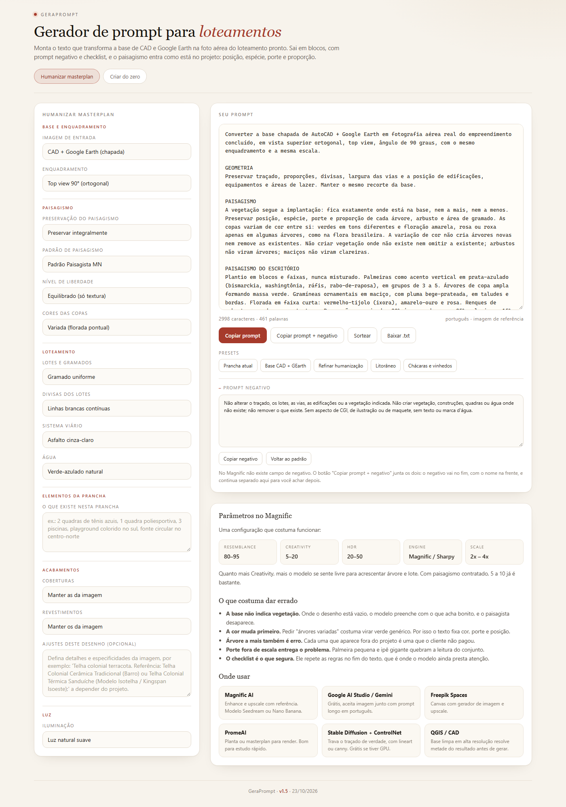

# GeraPrompt

Monta o prompt que transforma uma base de AutoCAD + Google Earth em fotografia aérea real de um loteamento, com fidelidade à implantação.

Roda 100% no navegador, sem instalar nada: <https://luizabgk.github.io/geraprompt/>



## Como usar

1. Abra o link.
2. Escolha a base, o enquadramento e o padrão de paisagismo.
3. Ajuste lotes, divisas, vias, água, acabamentos e luz.
4. Copie o prompt e cole no Magnific com a imagem da prancha.

## Novidades da versão 2.18

- **Masterplan — base técnica:** novo preset que usa uma planta técnica como referência e um prompt de edição para remover linhas vermelhas/legendas, preservar ruas/lotes/lagos e criar divisas brancas finas. Validado no GeraRender com Seedream 5 Pro Edit.
- **Masterplan top-down — Seedream:** o preset agora usa a referência top-down `masterplan_visao_geral.jpg` e trava a câmera em 90°. Use com Seedream 5 Pro Edit; o prompt pede lotes vazios, gramado uniforme e divisas brancas finas.
- **Playground com brinquedos:** o prompt agora pede explicitamente balanços e gangorra, além da estrutura principal.
- **Entrada padrão Alphaville:** referência trocada por portaria real de loteamento horizontal com pórtico, guarita e rotatória.
- **Playground com contexto + brinquedos:** referência virou um moodboard real com visão geral, balanços e gangorra.
- **Referências externas:** fotos do Wikimedia Commons em alta resolução, com autor e link registrados no manifesto.
- **Masterplan separado:** `Masterplan top-down` usa a referência aprovada + planta de divisas; `Masterplan oblíquo` usa o render 3D oblíquo do escritório.
- **Carros e reflexos por cena:** playground, haras, lago, quadra e masterplan não recebem mais textos genéricos de estacionamento/vidro.
- **Prompt deduplicado:** removidas repetições de contexto, lotes vazios e foco.
- **Salvar/carregar projeto:** agora salva a versão correta e o prompt negativo.
- **Cópia mais segura:** o fallback verifica se o comando de copiar realmente funcionou.
- **Quadra não vira piscina:** prompts de quadra agora pedem piso seco, linhas nítidas e nenhuma água sob a quadra.
- **Trava de água só com referência:** o bloco de controle de água não é mais enviado quando não há imagem de referência.
- **Copiar prompt + negativo:** o botão separado agora junta prompt positivo e negativo para ferramentas que aceitam campo de negativo.
- O botão **Copiar prompt** continua copiando somente o prompt principal, que é o correto para Mystic/Magnific.
- **Biblioteca de referências:** cada preset mostra resolução, origem e status da referência; o controle fica em `referencias/manifest.json`.
- **Masterplan com duas referências:** imagem visual aprovada + `loteamento_linhas.jpg` como estrutura para as divisas dos lotes continuarem aparecendo.
- **Lago e deck:** referência trocada para a versão preferida da Luiza.
- **Entrada do condomínio:** referência atualizada; ainda é conceito IA até entrar um render/foto oficial.
- **Copiar prompt limpo:** o botão não junta mais o negativo ao prompt. O Mystic não aceita campo negativo; colar o bloco junto piora a geração.
- **Controle de nitidez:** chip Nitidez máxima, foco em todo o quadro e negativo contra blur/motion blur.
- **Controle de nitidez:** novo chip Nitidez máxima, foco nítido em todo o quadro, alta velocidade de obturador e negativo contra blur/motion blur.
- **Masterplan oblíquo:** o antigo preset Masterplan aéreo foi renomeado e ajustado para câmera oblíqua 45°.
- **Ajustes do ponto 4:** clube com quadra, lago pequeno e contido, entrada com rotatória/portão, playground com uma estrutura principal, haras com cavalos/piquetes/arena.
- **Referência sugerida por preset:** cada preset do Criar do zero mostra uma miniatura, o caminho do arquivo e um botão para copiar o caminho.
- A referência deve ser escolhida no GeraRender como **imagem de referência de estilo**.
- **Criar do zero com lógica foto-real:** chip Fotografia real, luz natural suave por padrão, texturas, imperfeições, escala humana e bloqueio de aparência CGI.
- **Presets de cena:** Clube e lazer, Lago e deck, Playground tropical, Pavilhão e lago e Haras.
- Correção dos presets da aba Criar do zero, que não estavam aplicando os valores.
- **Trava de água:** o prompt manda manter lagos, lagoas e espelhos d'água no mesmo contorno, área e posição.
- Removidas referências a ambientes costeiros e ajustados os presets para o contexto de interior do Brasil.
- Prompt humanizar com **1.871 caracteres** no padrão (limite recomendado: ~2.000).
- Aviso visual quando o prompt passa de 2.000 caracteres.
- Opções de **preservação do paisagismo** e **nível de liberdade** agora entram de fato no prompt.
- Linguagem explícita de **vista superior ortogonal a 90°**.
- Copas coloridas: ipê-amarelo, quaresmeira rosa, ipê-roxo e branca.
- Checkbox **incluir casas nos lotes** no modo Criar do zero.
- Correção geral dos acentos e da codificação UTF-8.

## O que o prompt segura

- Traçado, lotes, vias e enquadramento da base.
- Posição, espécie, porte e proporção da vegetação indicada.
- Quadra continua quadra; edificação não ocupa área verde; água só onde está desenhada.
- Cores e texturas de telhado e revestimento já indicadas.

No Magnific/Mystic não existe campo de negativo. Use **Copiar prompt limpo** e não cole o bloco de negativo junto.

## Onde funciona

Qualquer modelo que aceite prompt de imagem. Já foi testado no Magnific com Seedream e Nano Banana; deve funcionar também no Gemini, Flux, SDXL e DALL·E.

## Rodando local

Baixe o `index.html` e abra no navegador. Não tem build, não tem dependência e não faz chamadas externas.

```bash
git clone https://github.com/luizabgk/geraprompt.git
cd geraprompt
```

## Licença

MIT. Veja [LICENSE](LICENSE).
