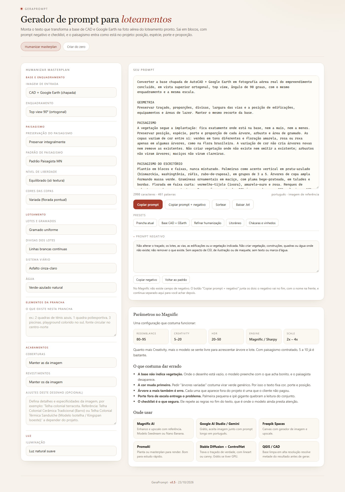

# GeraPrompt

Monta o prompt que transforma uma base chapada de AutoCAD + Google Earth em foto aérea do loteamento pronto.

Roda no navegador, sem instalar nada: <https://luizabgk.github.io/geraprompt/>



## Como usar

Abra o link e escolha o enquadramento, o paisagismo e os acabamentos. O prompt aparece à direita e muda a cada escolha.

No fim da página tem dois botões. "Copiar prompt" leva só o texto principal. "Copiar prompt + negativo" leva os dois juntos, com o negativo identificado no fim — é o que você usa no Magnific, que não tem campo separado para isso.

## O que ele entrega

Três coisas sempre juntas: o prompt, o prompt negativo e um checklist de preservação. O checklist vai no fim do prompt de propósito, porque é a última coisa que o modelo lê antes de gerar.

## O que o prompt segura

O traçado, os lotes, as vias e o enquadramento ficam como estão na base.

O paisagismo também. A posição, a espécie, o porte e a proporção de cada árvore, arbusto e área de gramado são mantidos. A cor varia entre tons de verde e uma floração pontual, mas nada é criado nem removido.

Equipamento não vira outra coisa: quadra continua quadra, com piso e linhas. Edificação não ocupa área verde. Água só onde está desenhada.

## Presets

Cinco combinações prontas: prancha atual, base CAD + GEarth, refinar humanização, litorâneo e chácaras com vinhedos. Servem como ponto de partida, não como receita.

## Padrão de paisagismo

O campo **Padrão de paisagismo** injeta no prompt uma paleta de espécies e proporções tirada da obra construída de um escritório brasileiro: palmeiras prateadas como acento vertical, árvores de copa ampla em massa, gramíneas ornamentais em maciço, florada em faixa curta e renques de arbusto. A paleta define aparência, não quantidade: aplica-se onde a base já indica vegetação, e quem decide posição e densidade é a implantação.

Escolha **Sem padrão de paisagismo** para outros contextos — aí o paisagismo vem apenas da base e do campo de ajustes.

## Onde funciona

Qualquer modelo que aceite prompt de imagem. Já foi testado no Magnific com Seedream e com Nano Banana; deve funcionar igual no Gemini, Flux, SDXL e DALL·E.

## Rodando local

Baixe o `index.html` e abra no navegador. Não tem build, não tem dependência.

```bash
git clone https://github.com/luizabgk/geraprompt.git
cd geraprompt
```

## Licença

MIT. Veja [LICENSE](LICENSE).
